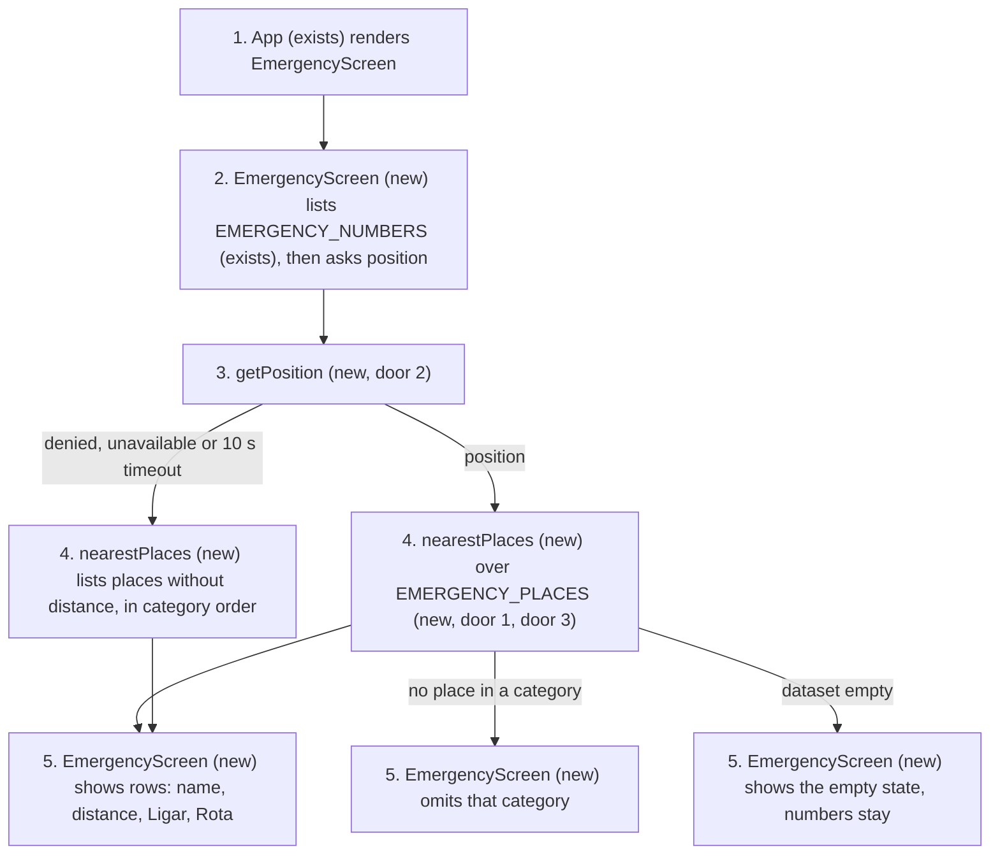
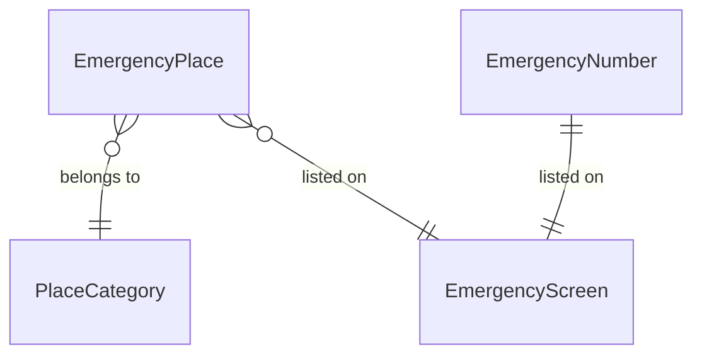
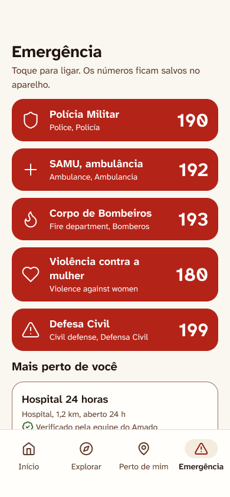
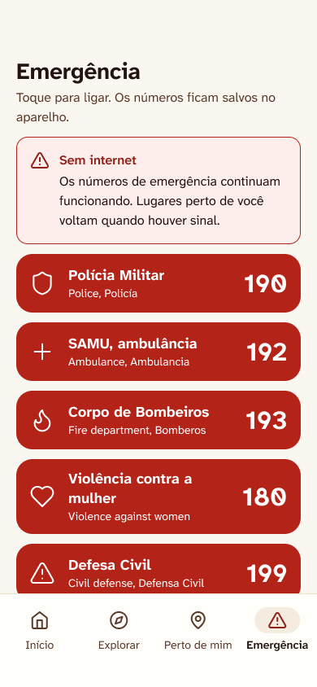

# Emergency: nearest places

**Approved**: 2026-10-28 - user: "aprovado"

## Problem

The Emergência screen today is a list of five phone numbers and nothing else. Someone who needs a
hospital, a police station or a fire station must already know where one is: the app shows no
place, no distance and no route. The Hack Turismo challenge names the pain as "acesso difícil a
serviços de emergência" (`docs/CONTEXT.md` §1); the source gives no figure for how often it
happens or what it costs.

When this ships, a tourist in Ilhéus opens Emergência and sees the five numbers at once, then the
nearest police station, hospital, UPA and fire station with distance, phone and route, with or
without internet, and the app keeps the position only for that look-up.

## Shape

Reuses `EMERGENCY_NUMBERS` and `telHref` in `src/features/emergency/numbers.ts` and the existing
PWA precache for offline. The rules that change an outcome (which places, in what order, how the
distance reads, what happens without a position) are pure functions in `src/features/emergency/`
that `pnpm test` (Vitest, jsdom) reaches.

1. open the app -> `App` (exists) - renders `EmergencyScreen` as the only screen
2. `EmergencyScreen` (new) - shows the five numbers from `EMERGENCY_NUMBERS` (exists) at once, then asks `getPosition` once
3. `getPosition` (new, door 2) - one `navigator.geolocation.getCurrentPosition` call, hands `{lat, lng}` on in memory, stores nothing
4. `nearestPlaces` (new) - filters `EMERGENCY_PLACES` (new, door 1, door 3) by category, computes distance, sorts by distance only
5. out: one row per category with name, distance, "Ligar" (`tel:`) and "Rota" (map link); the position is dropped when the call returns

**Changes underneath**

| Front       | What changes                                                                                                                                                                                                                                     |
| ----------- | ------------------------------------------------------------------------------------------------------------------------------------------------------------------------------------------------------------------------------------------------ |
| domain      | `EmergencyNumber.label` meant a short name ("SAMU", "Bombeiros"), now carries the capture's full wording ("SAMU, ambulância", "Corpo de Bombeiros") and a bilingual second line - `App.test.tsx` asserts `/192 · SAMU/` and branches on it today |
| domain      | `App` meant the bootstrap placeholder (heading "Amado", tagline, numbers), now means the Emergência screen as drawn - `App.test.tsx` asserts the heading and tagline today; the app name stays in `<title>` and the manifest                     |
| stored data | nothing to migrate: no stored data is touched, and `EMERGENCY_PLACES` is a bundled read-only module                                                                                                                                              |
| readers     | only `EmergencyScreen`; no other screen reads the places                                                                                                                                                                                         |

New: `EmergencyPlace` and its `PlaceCategory` (bundled, read only). One-way constraints:
`EmergencyPlace` has no rank, priority or payment field (door 1); the dataset is a static import,
not a runtime fetch (door 3).

## Surface

None - nothing consumed outside. The feature adds no route and no API; it opens external links
(`tel:` and a map link) and consumes the browser geolocation API.

## Landing

| One-way door                 | Literal shape                                                                                                                                                                                     | Alternative rejected                                                                                               |
| ---------------------------- | ------------------------------------------------------------------------------------------------------------------------------------------------------------------------------------------------- | ------------------------------------------------------------------------------------------------------------------ |
| 1. the `EmergencyPlace` type | `{ id: string; category: 'police' \| 'hospital' \| 'upa' \| 'fire'; name: string; phone: string; lat: number; lng: number; hours?: string; verifiedAt: string; source: string }` - no other field | a `priority` or `order` field - it lets a record outrank another, which breaks "never ordered by payment" (AD-004) |
| 2. position handling         | `getPosition(): Promise<{ lat: number; lng: number }>` is the only code that touches `navigator.geolocation`; the feature imports no storage, analytics or logging                                | caching the last position for a faster first paint - it stores a position, which CLAUDE.md forbids                 |
| 3. how the dataset ships     | `export const EMERGENCY_PLACES: readonly EmergencyPlace[]` in a `.ts` module imported statically, so it lands in the precached bundle                                                             | fetching a JSON at runtime - it fails offline, which AD-001 requires to work                                       |

- Nothing else in this change is hard to reverse

## Criteria

### S1: The five numbers (P1)

The five level 1 numbers are on screen at once, tappable, and never wait for anything.

**Acceptance Criteria**

1. WHEN a user opens the app THEN the system SHALL show the screen in `.specs/features/emergency-near-me/captures/emergencia.png`
2. The system SHALL list the numbers in the order 190, 192, 193, 180, 199, each as a link `tel:<number>` showing the title and second line exactly as the capture draws them
   - 190 → "Polícia Militar" / "Police, Polícia"; 192 → "SAMU, ambulância" / "Ambulance, Ambulância"; 193 → "Corpo de Bombeiros" / "Fire department, Bombeiros"; 180 → "Violência contra a mulher" / "Violence against women"; 199 → "Defesa Civil" / "Civil defense, Defesa Civil"
3. WHILE the position is pending, denied or failed, or the device is offline, the system SHALL keep all five number links visible and tappable, with the same `href`s
4. The system SHALL show no "patrocinado" label anywhere on the screen

### S2: Nearest places (P1)

The nearest place of each category, by distance, with a way to call and a way to get there.

**Acceptance Criteria**

5. WHEN the screen opens THEN the system SHALL call `navigator.geolocation.getCurrentPosition` exactly once, with `maximumAge: 0` and `timeout: 10000`, and SHALL never call `watchPosition`
6. WHEN a position is available THEN the system SHALL show under the heading "Mais perto de você" the one nearest place of each category (police, hospital, upa, fire) that has at least one place, ordered by ascending distance
   - police at 500 m and hospital at 1.2 km → police row first; two categories at exactly the same distance → `police`, `hospital`, `upa`, `fire` order; a category with no place → no row for it
7. The system SHALL write the distance as metres rounded to 10 below 995 m and as kilometres with one decimal and a comma from 995 m up
   - 994 m → "990 m"; 995 m → "1,0 km"; 1234 m → "1,2 km"; 0 m → "0 m"
8. The system SHALL show on each place row its name, its category, its distance, "Verificado pela equipe do Amado", and the place's `hours` when it has one
9. WHEN a user uses "Ligar" on a place row THEN the system SHALL open the dialer with `tel:<place phone>`
10. WHEN a user uses "Rota" on a place row THEN the system SHALL open the Google Maps directions link whose `destination` is that place's `<lat>,<lng>`, and SHALL NOT put the user's position in the link
11. IF the position is denied, unavailable or does not arrive in 10 s THEN the system SHALL show every place without a distance, ordered by category (`police`, `hospital`, `upa`, `fire`) then by `id`, under the line "Sem a sua localização, não dá para ordenar por distância."
12. WHILE the position is pending the system SHALL show a loading block under "Mais perto de você" and SHALL NOT delay or disable the number links
13. IF `EMERGENCY_PLACES` has no place THEN the system SHALL show under "Mais perto de você" the text "Ainda não há lugares verificados para mostrar. Os números acima funcionam sempre."
14. IF a place lacks any of `id`, `name`, `phone`, `lat`, `lng`, `verifiedAt`, `source`, or has a coordinate outside -90..90 / -180..180 THEN `validatePlace` SHALL reject it
    - missing `source` → rejected; `lat` 91 → rejected; `lng` -181 → rejected; a place with every field and `hours` absent → accepted

### S3: Works offline (P1)

The places do not need the network; the alert says so.

**Acceptance Criteria**

15. WHILE the device is offline (`navigator.onLine` is false) the system SHALL show the same places and distances as when online, and the feature SHALL make no network request of its own
16. WHEN the device goes offline or online (`offline` and `online` events) THEN the system SHALL show or remove the alert without a reload
17. WHILE the device is offline the system SHALL show above the numbers the alert in `.specs/features/emergency-near-me/captures/emergencia-sem-internet.png` with title "Sem internet" and text "Os números de emergência e os lugares salvos no aparelho continuam funcionando."

### S4: The position is never kept (P1)

The position is used for one look-up and then gone.

**Acceptance Criteria**

18. The system SHALL NOT write the position to `localStorage`, `sessionStorage`, `indexedDB`, `document.cookie`, the console, or any network request
    - after a successful look-up, all five stores hold nothing from it, the console receives no call carrying a coordinate, and `fetch` and `XMLHttpRequest` are not called
19. The system SHALL NOT import any storage, analytics or logging module inside `src/features/emergency/`
20. The system SHALL order places by distance only; `EmergencyPlace` SHALL have no field that can change that order
    - two places with the same coordinates and different `id` → ordered by `id`, not by any other value

## Out of scope

| Excluded                                                      | Why                                                                                  |
| ------------------------------------------------------------- | ------------------------------------------------------------------------------------ |
| The 4-tab bottom bar                                          | AD-003: the other tabs do not exist yet                                              |
| Level 2 urgencies (chaveiro, guincho, farmácia de plantão...) | a separate feature with its own data and its own ordering rule                       |
| The general "Perto de mim" tab (Gastronomia, Cultura, Praias) | a different screen in the design, for discovery rather than emergency                |
| Language switching                                            | the bilingual lines are static copy as drawn; choosing a language is another feature |
| Collecting the real places                                    | AD-002: the team does it from a checked source                                       |
| A map view of the places                                      | the capture draws a list, not a map                                                  |
| The first-open consent screen (Localização)                   | it is another screen; this feature asks the browser for the position at use time     |

## Assumptions

| Assumption                                                     | Chosen default                                                     | Rationale                                                                                    | Confirmed? |
| -------------------------------------------------------------- | ------------------------------------------------------------------ | -------------------------------------------------------------------------------------------- | ---------- |
| Places offline vs needing signal                               | bundled in the app, work offline                                   | AD-001                                                                                       | y          |
| Where the real places come from                                | dataset ships empty, honest empty state                            | AD-002                                                                                       | y          |
| Bottom bar                                                     | omitted                                                            | AD-003                                                                                       | y          |
| When the position is requested                                 | on opening the screen, with no extra button                        | the capture draws the list with no "use my location" control                                 | n          |
| How many places per category                                   | the nearest one                                                    | in an emergency the nearest of each kind matters more than a top-N that may be all hospitals | n          |
| Without a position                                             | every place, no distance, category order then `id`                 | a nearest list cannot be computed; showing everything beats showing nothing                  | n          |
| Route link                                                     | Google Maps directions URL with only the destination               | opens the maps app on Android and iOS; `geo:` is not handled by iOS Safari                   | n          |
| Wording of the loading block, empty state and no-position line | the strings in criteria 11 and 13; the loading block shows no text | no capture draws these states                                                                | n          |
| The bootstrap heading "Amado" and tagline                      | replaced by the screen title "Emergência" as drawn                 | the capture draws no brand header; the name stays in `<title>` and the manifest              | n          |
| Position options                                               | `maximumAge: 0`, `timeout: 10000`, no `watchPosition`              | "used on the spot": a cached or continuous fix would keep the position longer                | n          |
| Distance formula                                               | great-circle (haversine) over lat and lng in degrees               | straight-line distance is enough to rank; the route is the maps app's job                    | n          |

**Open questions:** none - all resolved or logged above.

## Differences from the source

| Source shows                                                      | Product shows                                                                           | Confirmed  |
| ----------------------------------------------------------------- | --------------------------------------------------------------------------------------- | ---------- |
| the bottom bar with Início, Explorar, Perto de mim, Emergência    | no bottom bar                                                                           | y - AD-003 |
| "Lugares perto de você voltam quando houver sinal."               | "Os números de emergência e os lugares salvos no aparelho continuam funcionando."       | y - AD-001 |
| a sample row "Hospital 24 horas", "Hospital, 1,2 km, aberto 24 h" | the rows of the verified dataset, which ships empty, so the empty state in criterion 13 | y - AD-002 |

## Sources

- `docs/CONTEXT.md` §1, §4, §7 - the pain, the level 1 scope and the location rule
- `CLAUDE.md` non-negotiables and `.claude/rules/emergency.md` - level 1 never sponsored, works offline, position never stored, no invented data
-  - binding - the screen: title, the five numbers with bilingual lines, "Mais perto de você" (Figma `Telas do MVP`, frame `Emergência`, exported 2026-10-28)
-  - binding - the offline alert above the numbers (Figma `Telas do MVP`, frame `Emergência sem internet`, exported 2026-10-28)
- Figma `Amado - Design System`, https://www.figma.com/design/WXIGC7S27jGpu33VfOoeSC/ - binding - tokens and components (`Emergency Call`, `Place Row`, `Alert`)
