# P1 screens

**Approved**: 2026-10-28 - user: "Pode implementar"

## Problem

The app is one screen. A visitor cannot choose a language, is never told what the app collects, cannot
move between screens, cannot change the appearance or the data choice, and cannot see anything to
discover in Ilhéus. A tourist who does not read Portuguese cannot use even the Emergência screen. The
Figma "Princípios e acessibilidade" asks for Portuguese, English and Spanish, a language chosen on the
first screen, dark and high contrast modes, and socorro access on every screen; `docs/CONTEXT.md` §7 asks
for a first-open explanation and a permission. The source gives no figure for how many visitors this
loses.

When this ships, a first-time visitor picks a language, reads what is collected and chooses, and lands in
an app with a bar to move between Início, Perto de mim and Emergência. Emergência is one tap away from
every screen, including the first two. The visitor can change language, appearance and the data choice in
Perfil, and everything reads in three languages and works offline.

## Shape

Reuses `EmergencyScreen`, `numbers.ts` and `src/styles/tokens.css`, and the existing PWA precache for
offline. The rules that change an outcome (which route shows, which language, how preferences are read,
how places filter, how the date and distance read) are pure functions in `src/app/`, `src/i18n/` and
`src/features/places/` that `pnpm test` (Vitest, jsdom) reaches.

1. open the app or change `location.hash` -> `Router` (new, door 1) - turns the hash into a route and applies the onboarding guard
2. `Router` (new, door 1) -> `AppShell` (new) - renders the screen of the route and, on in-app routes, `TabBar` (new)
3. `PreferencesStore` (new, door 2) - reads and writes language, theme, onboarding and countVisit in `localStorage`, never throws
4. `I18n` (new, door 3) - `t(key)` over three typed dictionaries, and the language detection
5. the screens (new): `LanguageScreen`, `ConsentScreen`, `HomeScreen`, `NearbyScreen`, `PlaceScreen`, `ProfileScreen`, `PrivacyScreen`, and `EmergencyScreen` (exists) rendered by the shell
6. `PlacesSource` (new, door 4) - `loadPlaces()` resolves `EXAMPLE_PLACES` (new), which `HomeScreen`, `NearbyScreen` and `PlaceScreen` filter and show
7. out: the screen, `document.documentElement.lang`, `data-theme`, and the stored preferences read again on the next open

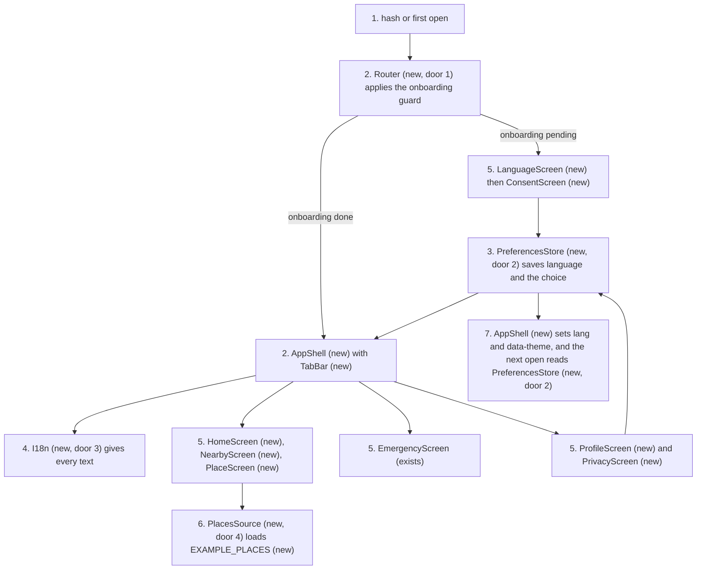

**Changes underneath**

| Front       | What changes                                                                                                                                                                                                                          |
| ----------- | ------------------------------------------------------------------------------------------------------------------------------------------------------------------------------------------------------------------------------------- |
| domain      | `App` meant the Emergência screen alone (AD-003), now means the shell and `EmergencyScreen` is one route - `App.test.tsx` asserts the Emergência heading on open and branches on it today                                             |
| domain      | `EmergencyNumber.label` and `subtitle` meant Portuguese plus "Police, Polícia", now come from the language per AD-010 - `numbers.ts`, `EmergencyScreen.tsx` and `EmergencyScreen.test.tsx` ("lists the five numbers") read them today |
| domain      | the Emergência copy was Portuguese literals, now comes from `I18n`; `privacy.test.ts` scans `src/features/emergency/` for storage words, so the language reaches it through a hook from `src/i18n/` and no storage is read there      |
| stored data | nothing to migrate: this is the first thing the app writes to `localStorage`, under one new key (door 2)                                                                                                                              |
| readers     | every screen reads language and theme; `tokens.css` reads `data-theme`; `EmergencyScreen` reads the language only                                                                                                                     |

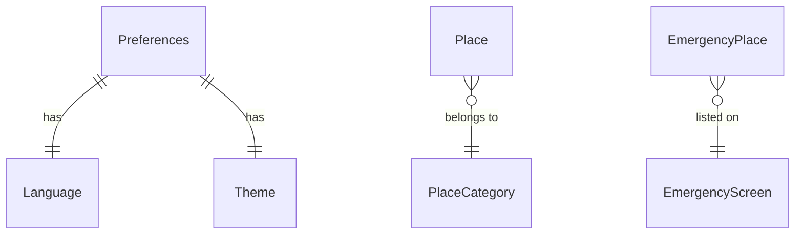

New: `Preferences`, `Language`, `Theme`, `Place` and `PlaceCategory` (example content). One-way
constraints: the hash route shape (door 1), the stored preferences key and fields (door 2), flat typed
message keys (door 3), and the `loadPlaces()` contract with a `Place` that has no phone, address or rank
(door 4).

## Surface

None - nothing consumed outside. The hash routes are used only inside the app today, but a QR code or a
link that someone prints later will consume them, which is why door 1 is recorded.

## Landing

| One-way door          | Literal shape                                                                                                                                                                                                                                            | Alternative rejected                                                                                                                                            |
| --------------------- | -------------------------------------------------------------------------------------------------------------------------------------------------------------------------------------------------------------------------------------------------------- | --------------------------------------------------------------------------------------------------------------------------------------------------------------- |
| 1. route shape        | hash routes: `#/idioma`, `#/localizacao`, `#/inicio`, `#/perto-de-mim`, `#/lugar/<id>`, `#/emergencia`, `#/perfil`, `#/privacidade`                                                                                                                      | path routes such as `/emergencia` - they need a server rewrite on every host, and a printed QR code cannot be reissued when a host lacks it                     |
| 2. stored preferences | one `localStorage` key `amado.preferences.v1` holding `{"language":"pt"\|"en"\|"es","theme":"auto"\|"light"\|"dark"\|"contrast","onboarding":"pending"\|"done","countVisit":true\|false}` and nothing else                                               | cookies - they are sent on every request and readable on the server, which the privacy rule does not want for a choice that never leaves the device             |
| 3. message keys       | flat dotted keys, one `Record<MessageKey, string>` per language, so a missing key is a type error                                                                                                                                                        | an i18n library with catalogues fetched at runtime - it adds a dependency and fails offline unless bundled, and there is no plural or gender rule to justify it |
| 4. places source      | `loadPlaces(): Promise<readonly Place[]>` with `Place = { id: string; category: 'gastronomia' \| 'cultura' \| 'praias'; name: string; summary: Record<Language, string>; example: true }` and no phone, address, coordinate, opening hours or rank field | a synchronous array import - the real source will be asynchronous, and the loading and error states of the captures need it to be                               |

- Nothing else in this change is hard to reverse

## Criteria

### S1: Navigation (P1)

The app opens where it should and the bar moves between the screens.

**Acceptance Criteria**

1. WHEN the app opens with no stored preferences THEN the system SHALL show Idioma as in `.specs/features/p1-screens/captures/idioma.png` at `#/idioma`
2. WHEN the app opens with onboarding done and no hash THEN the system SHALL show Início as in `.specs/features/p1-screens/captures/inicio.png` at `#/inicio`
3. IF the hash matches no route THEN the system SHALL show Início when onboarding is done and Idioma when it is pending
   - `#/xyz` and `#/lugar/` with onboarding done → Início; `#/lugar/unknown-id` → Perto de mim; `#/xyz` with onboarding pending → Idioma
4. The system SHALL show the bar with Início, Perto de mim and Emergência on `#/inicio`, `#/perto-de-mim`, `#/lugar/<id>`, `#/emergencia`, `#/perfil` and `#/privacidade`, on `#/idioma` once onboarding is done, and on no other route
5. WHEN a user taps a tab THEN the system SHALL go to that tab's route and mark it with `aria-current="page"`
   - `#/lugar/<id>` marks Perto de mim; `#/perfil` and `#/privacidade` mark no tab
6. WHEN a user uses Back in the browser or on the device THEN the system SHALL return to the previous screen without reloading
7. WHILE onboarding is pending, WHEN a user taps the Início or Perto de mim tab THEN the system SHALL show Idioma, and Emergência SHALL stay reachable
8. WHEN a user opens Emergência THEN the system SHALL show the screen in `.specs/features/p1-screens/captures/emergencia.png` with the three-tab bar and with each service name by criterion 36

### S2: Languages and preferences (P1)

Three languages, chosen once, remembered, never breaking the app.

**Acceptance Criteria**

9. WHEN no language is stored THEN the system SHALL pick `en` or `es` when `navigator.language` starts with them, ignoring case, and `pt` otherwise
   - `en-US` → `en`; `es-419` → `es`; `ES` → `es`; `pt-BR` → `pt`; `fr` → `pt`; empty → `pt`
10. WHEN a user picks a language on Idioma THEN the system SHALL change every text of the screen at once and set `document.documentElement.lang` to `pt-BR`, `en` or `es`
11. The system SHALL have a non-empty text in `pt`, `en` and `es` for every message key
12. WHEN the language, theme, onboarding or countVisit changes THEN the system SHALL store it under `amado.preferences.v1` and read the same values on the next open
13. IF the stored preferences are missing, unparseable or hold an unknown value THEN the system SHALL use the default for that field and SHALL NOT throw
    - invalid JSON → all defaults; `language: "fr"` → detected language; `theme: "neon"` → `auto`; `countVisit: "yes"` → `false`; a valid field next to a bad one → the valid field is kept
14. IF `localStorage` throws on read or write THEN the system SHALL keep the preferences in memory for the session and SHALL NOT throw
15. The system SHALL NOT write anything but language, theme, onboarding and countVisit under `amado.preferences.v1`
    - a position, a place id and a search text never appear in the stored value

### S3: First open (P1)

The two first screens, with socorro one tap away.

**Acceptance Criteria**

16. WHEN a user taps a language on Idioma THEN the system SHALL mark it selected, and Continuar SHALL store it and show Localização as in `.specs/features/p1-screens/captures/localizacao.png`
17. The system SHALL show on Idioma the three titles "Escolha o idioma", "Choose your language" and "Elige tu idioma" in every language, and the line "Você pode trocar depois, no perfil." in the chosen language
18. WHEN a user taps the Emergência shortcut on Idioma or Localização THEN the system SHALL show Emergência and leave onboarding pending
19. WHEN a user taps "Permitir localização" THEN the system SHALL ask the browser for the position once, store onboarding `done`, store countVisit `true` when it is granted and `false` when it is denied, and show Início
20. WHEN a user taps "Agora não" THEN the system SHALL store onboarding `done` and countVisit `false`, SHALL NOT ask the browser, and SHALL show Início
21. WHILE onboarding is pending the system SHALL show no bar on Idioma and Localização
22. WHEN a user opens Idioma from Perfil THEN the system SHALL show it without the shortcut and with the bar and Continuar SHALL store the language and return to Perfil

### S4: Discover (P1)

Início, Perto de mim and Lugar, with example content that says it is an example.

**Acceptance Criteria**

23. WHEN a user opens Início THEN the system SHALL show the title "Hoje em Ilhéus", today's date as weekday, day and month in the chosen language, the search field, the category chips, the "Para fazer hoje" list and the Perfil icon, as in `.specs/features/p1-screens/captures/inicio.png`
    - 2026-10-28 → pt "Quarta, 28 de outubro"; en "Wednesday, October 28"; es "Miércoles, 28 de octubre"; 2026-01-01 → pt "Quinta, 1 de janeiro"
24. WHEN a user types in the search field THEN the system SHALL list the places whose name or summary contains the text, ignoring case and accents, and all of them when the field is empty
    - "vesuvio" → Bar Vesúvio; "JORGE" → Casa de Jorge Amado; "xyz" → none
25. WHEN a user taps a category chip THEN the system SHALL show only that category and mark the chip selected, with "Tudo" selected on opening and one chip selected at a time
26. WHEN a user taps a place card THEN the system SHALL show Lugar as in `.specs/features/p1-screens/captures/lugar.png` for that place
27. WHEN a user taps the Perfil icon, named "Abrir perfil", on Início or Perto de mim THEN the system SHALL show Perfil
28. WHEN a user opens Perto de mim THEN the system SHALL show the title, the chips and the list as in `.specs/features/p1-screens/captures/perto-de-mim.png`, with every example place tagged "Exemplo" and showing "Sem distância"
29. WHILE `loadPlaces()` is pending the system SHALL show the loading blocks of `.specs/features/p1-screens/captures/perto-de-mim-carregando.png` and keep the bar usable
30. IF the chosen category has no place THEN the system SHALL show the empty state of `.specs/features/p1-screens/captures/perto-de-mim-sem-resultado.png` with the action "Ver todos os lugares", which selects "Tudo"
    - Praias → empty state; Gastronomia → one place; Cultura → two places; Tudo → all three
31. IF `loadPlaces()` rejects THEN the system SHALL show the error block of `.specs/features/p1-screens/captures/perto-de-mim-com-erro.png` and "Tentar de novo" SHALL load again
32. WHILE the location permission is not granted, WHEN a user opens Perto de mim THEN the system SHALL show the warning and the action "Como ligar a localização" of `.specs/features/p1-screens/captures/perto-de-mim-sem-localizacao.png`, and the action SHALL show Privacidade e dados
33. WHEN a user opens Lugar THEN the system SHALL show Voltar, the photo area, the "Exemplo" tag, the place name and its summary in the chosen language, and Voltar SHALL return to the previous screen
34. IF a place has no coordinate THEN the system SHALL show no distance and no route action for it
35. The system SHALL show no "patrocinado" label anywhere in P1

### S5: Emergência in three languages (P1)

The screen that matters most reads in the visitor's language.

**Acceptance Criteria**

36. The system SHALL show each service name with the title in the chosen language and the other two languages as the second line
    - pt: 190 "Polícia Militar" and "Police, Policía"; en: 190 "Police" and "Polícia, Policía"; es: 190 "Policía" and "Police, Polícia"; the other four numbers in the same way over the table `numbers.ts` holds
37. The system SHALL show the Emergência title, lead, "Mais perto de você", the empty and no-position lines, "Ligar" and "Rota" in the chosen language
38. WHILE the device is offline the system SHALL show the alert of `.specs/features/p1-screens/captures/emergencia-sem-internet.png` in the chosen language, above the numbers
39. The system SHALL keep the five numbers linking `tel:190`, `tel:192`, `tel:193`, `tel:180` and `tel:199` in every language

### S6: Perfil and Privacidade (P1)

What the visitor chooses about the app, one tap from anywhere in the app.

**Acceptance Criteria**

40. WHEN a user opens Perfil THEN the system SHALL show Voltar, the Idioma row with the language's own name, the four appearance options and the Privacidade row, as in `.specs/features/p1-screens/captures/perfil.png`
41. WHEN a user taps the Idioma row THEN the system SHALL show Idioma by criterion 22
42. WHEN a user taps an appearance option THEN the system SHALL mark it selected, store it and set `data-theme` on the document to `light`, `dark` or `contrast`, and remove it for "Automático"
43. WHEN a user taps the Privacidade row THEN the system SHALL show Privacidade e dados as in `.specs/features/p1-screens/captures/privacidade.png`
44. WHEN a user taps the "Contar a minha visita" switch THEN the system SHALL flip countVisit, store it and write "Ligado" or "Desligado" beside the switch
45. The system SHALL show the row "Localização do aparelho" with "Permitida", "Negada" or "Não perguntada" for the browser permission states granted, denied and prompt, and "Não perguntada" when the browser cannot tell
46. WHEN a user taps Voltar on Perfil or Privacidade THEN the system SHALL return to the previous screen, and to Início when there is none

## Out of scope

| Excluded                                                                                            | Why                                                                                                                  |
| --------------------------------------------------------------------------------------------------- | -------------------------------------------------------------------------------------------------------------------- |
| Explorar, Circuito, Evento, Busca as a screen, Urgências do dia a dia, Avaliar, Relatar um problema | the second round (AD-007); the bar has three tabs until Explorar exists (AD-005)                                     |
| Real places, events, circuits and providers                                                         | no verified data exists; example content stands in (AD-008)                                                          |
| Collecting any data                                                                                 | countVisit is only stored; no report or analytics exists, and that is a separate feature with its own privacy review |
| The map, the trade panel, reports for the Secretaria                                                | P3 and outside the tourist app                                                                                       |
| Install prompt, 404 page                                                                            | P3                                                                                                                   |
| Translating place names                                                                             | names are proper names; only the summary is translated                                                               |

## Assumptions

| Assumption                                     | Chosen default                                                                                                                           | Rationale                                                                                             | Confirmed? |
| ---------------------------------------------- | ---------------------------------------------------------------------------------------------------------------------------------------- | ----------------------------------------------------------------------------------------------------- | ---------- |
| Bar has three tabs and shows on Emergência     | three tabs, also on Emergência                                                                                                           | AD-005                                                                                                | y          |
| Perfil opens from a header icon                | on Início and Perto de mim, not on Emergência                                                                                            | AD-006                                                                                                | y          |
| Content is example content                     | three tagged places, no phone, address, coordinate or hours                                                                              | AD-008                                                                                                | y          |
| Emergência shortcut on the first two screens   | a pill that goes to Emergência                                                                                                           | AD-009                                                                                                | y          |
| Service names                                  | title in the language, the other two as the second line                                                                                  | AD-010                                                                                                | y          |
| Hash routing                                   | hash routes, no server rewrite                                                                                                           | door 1                                                                                                | n          |
| While onboarding is pending                    | Início and Perto de mim send to Idioma; Emergência stays reachable                                                                       | the guard keeps the two first screens first without blocking socorro                                  | n          |
| "Permitir localização" and countVisit          | countVisit follows the browser answer                                                                                                    | CONTEXT §7: whoever refuses is not counted                                                            | n          |
| Location state on Perto de mim and Privacidade | read from the browser Permissions API, "not granted" when it cannot tell                                                                 | no other source of the permission exists                                                              | n          |
| English and Spanish copy                       | written by the builder and reviewed by the team before going live                                                                        | the source has no translated copy except the numbers                                                  | n          |
| Example places                                 | Bar Vesúvio and Casa de Jorge Amado and Catedral de São Sebastião (the names the Figma shows) in Gastronomia and Cultura, none in Praias | Praias empty makes the empty state reachable without inventing a place                                | n          |
| Perto de mim subtitle                          | "Lugares de exemplo em Ilhéus" while the content is example                                                                              | "Aberto agora, do mais perto ao mais longe" would claim hours and distances the example content lacks | n          |
| Dark and high contrast                         | `data-theme` overrides the system preference; "Automático" follows it                                                                    | the tokens already switch with the system                                                             | n          |

**Open questions:** none - all resolved or logged above.

## Differences from the source

| Source shows                                                                                             | Product shows                                                                                           | Confirmed             |
| -------------------------------------------------------------------------------------------------------- | ------------------------------------------------------------------------------------------------------- | --------------------- |
| the bar with Início, Explorar, Perto de mim and Emergência, on every screen that has it                  | the bar with Início, Perto de mim and Emergência                                                        | y - AD-005            |
| "Police, Polícia" as the second line of "Polícia Militar", and the same pattern for the other four       | the other two languages as the second line, "Police, Policía" in Portuguese                             | y - AD-010            |
| distances and opening hours on the place cards, and a sponsored card                                     | "Sem distância", no hours and no sponsored card                                                         | y - AD-008            |
| "Aberto agora, do mais perto ao mais longe" under Perto de mim and "Nenhum lugar aberto nesta categoria" | "Lugares de exemplo em Ilhéus" and "Nenhum lugar nesta categoria"                                       | y - AD-008            |
| "Última atualização às 09h14." in the error block                                                        | the line without the time                                                                               | y - AD-008            |
| on Lugar: Horário, Onde fica, Ver rota, Avaliar este lugar and Relatar um problema                       | none of them: the first three need data the example content lacks and the last two are the second round | y - AD-007 and AD-008 |
| the chips Gastronomia, Cultura and Praias on Perto de mim, with Gastronomia selected                     | the chips Tudo, Gastronomia, Cultura and Praias, with Tudo selected                                     | y - AD-013            |
| a sample row "Hospital 24 horas" under "Mais perto de você" on Emergência                                | the empty line of criterion 37, because the verified places dataset ships empty                         | y - AD-002            |
| the "Lugar" bottom sheet over the list                                                                   | not built                                                                                               | y - AD-011            |
| the card "Circuito cultural do centro" on Início                                                         | not built                                                                                               | y - AD-012            |

## Sources

- `docs/TELAS.md` - the screen map, with the decisions of 2026-10-28
- `docs/CONTEXT.md` §4 and §7, `CLAUDE.md` non-negotiables - privacy, scope, emergency rules
- 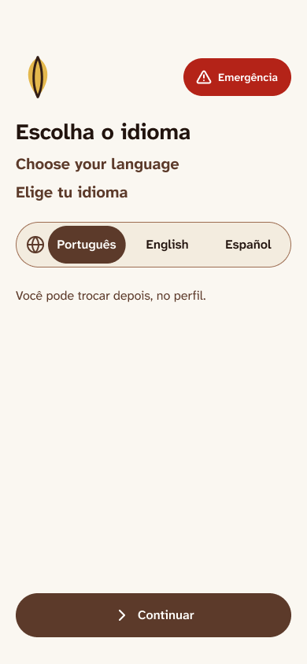 - binding - the first screen with the Emergência shortcut (Figma `Telas do MVP`, exported 2026-10-28)
- 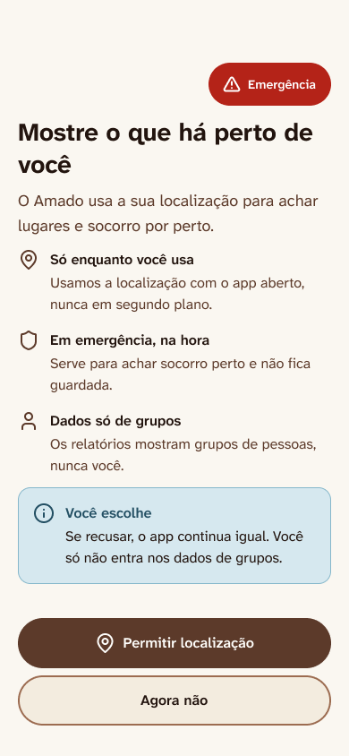 - binding - what is collected and the two choices, with the shortcut
- 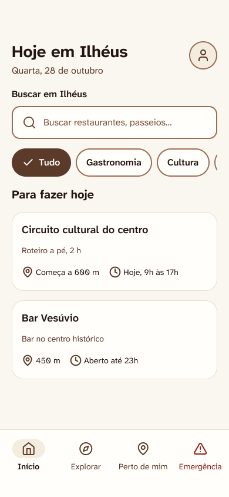 - binding - today in Ilhéus, search, chips, list, Perfil icon
- 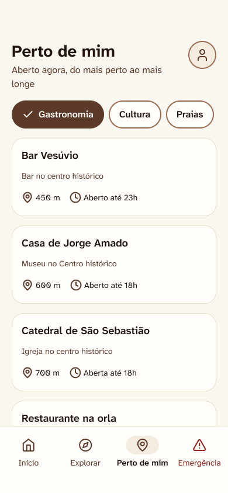 - binding - the list and its chips
- 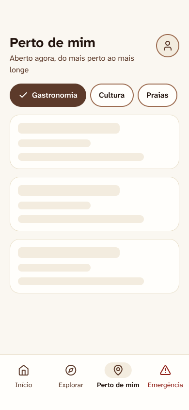 - binding - the loading state
- 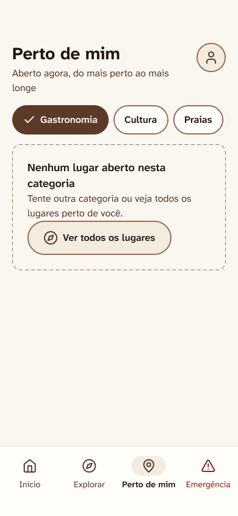 - binding - the empty state
- 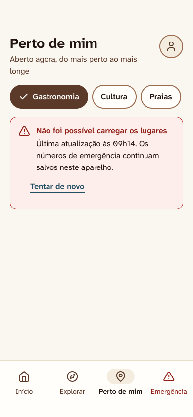 - binding - the error state
- 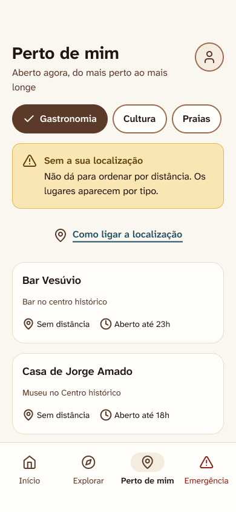 - binding - the state without a location
- 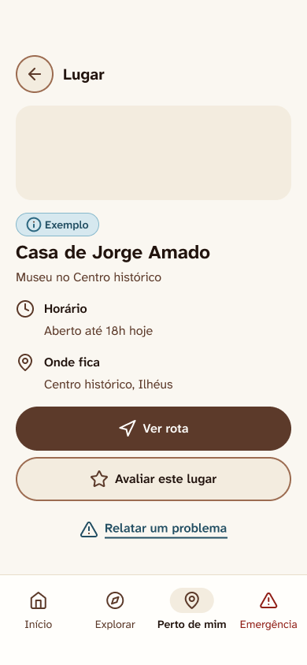 - binding - the place page
- 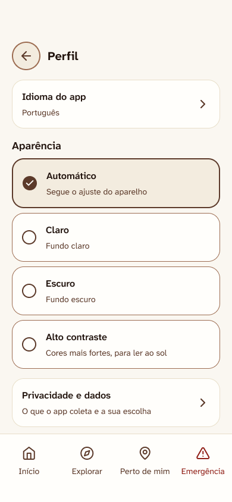 - binding - language, appearance, privacy
- 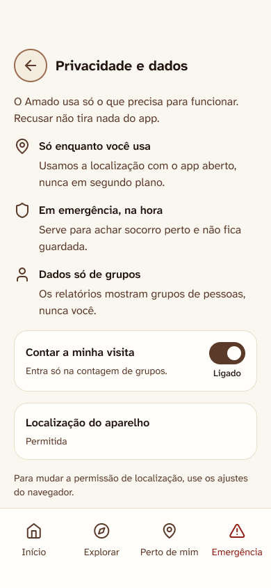 - binding - what is collected and the switch
- 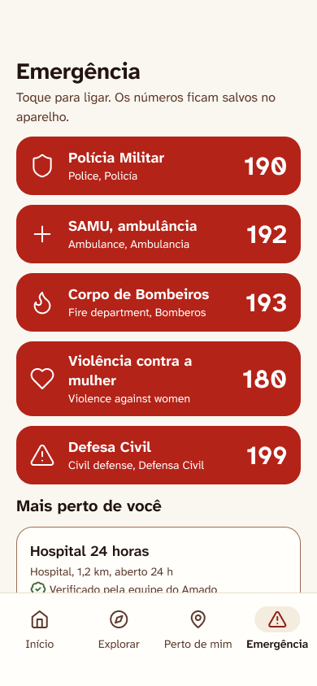 - binding - the numbers and "Mais perto de você" with the bar
- 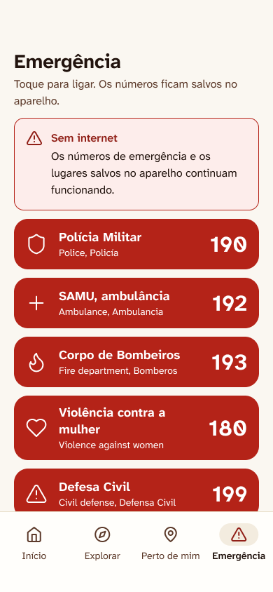 - binding - the offline alert
- Figma `Amado - Design System`, https://www.figma.com/design/WXIGC7S27jGpu33VfOoeSC/ - binding - tokens and components
