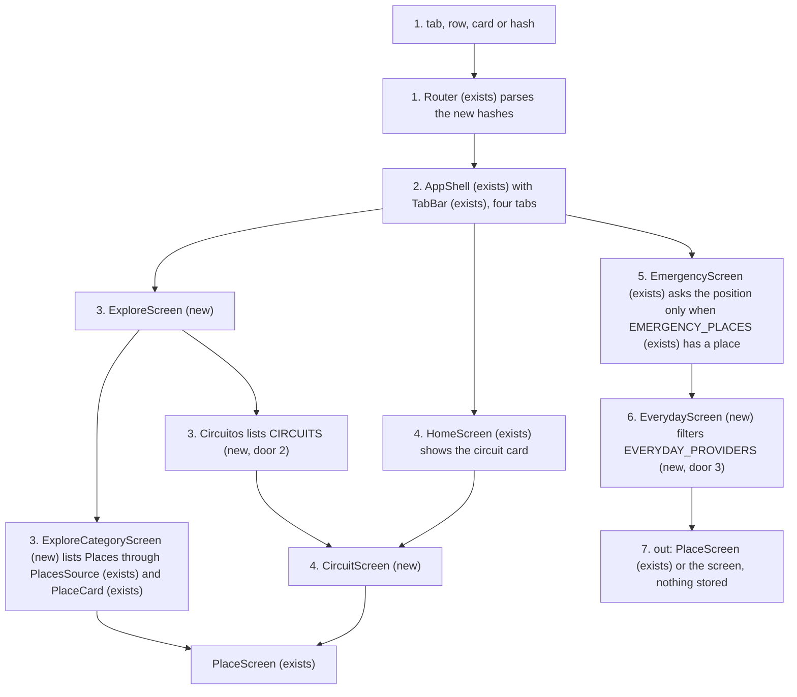
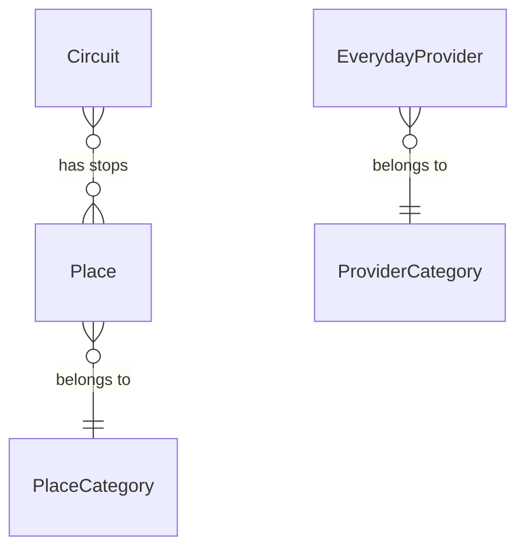
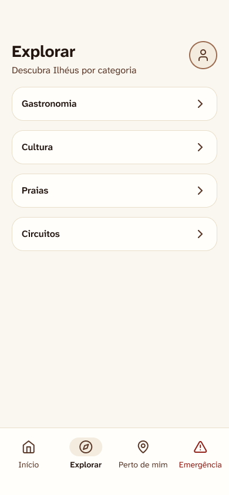
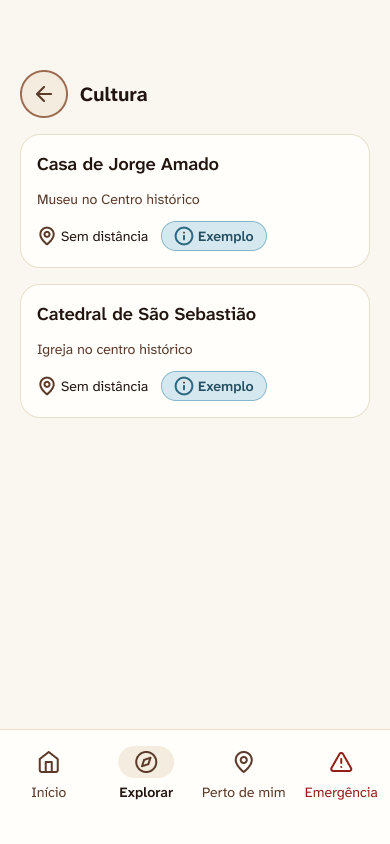
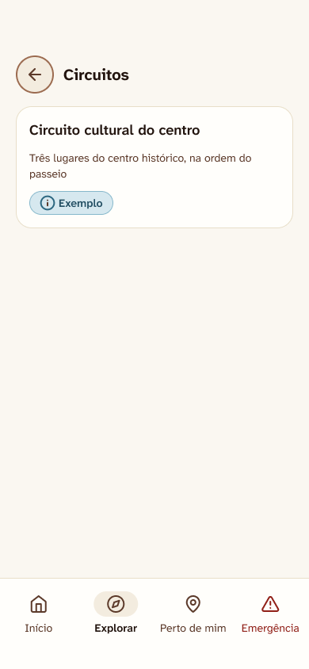
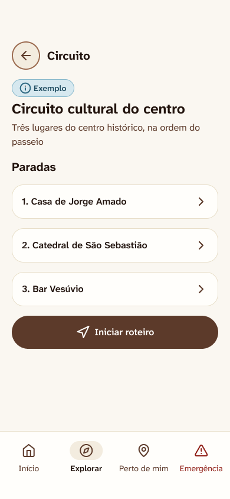
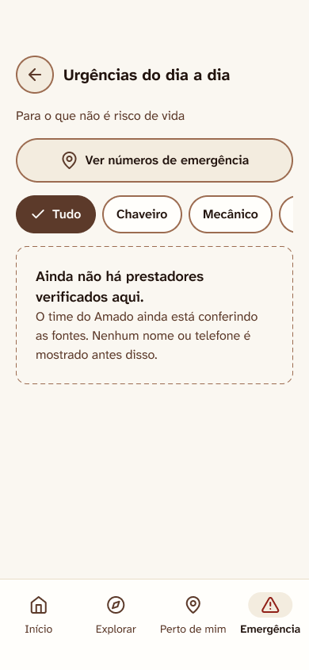
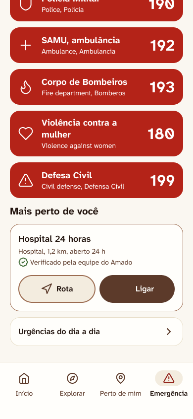
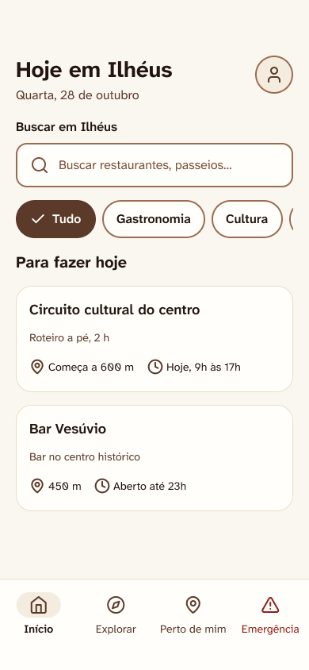

# P2 screens

**Approved**: 2026-10-29 - user: "Aprovado, pode seguir com o plano da P2, implemente usando as skill que temos disponíveis par auxiliar nesse processo"

## Problem

The bar has three tabs and the Figma draws four: a visitor who is not near anything has no way to browse Ilhéus,
because Início is "today and near" and Perto de mim is "open now". The Figma also draws the card "Circuito
cultural do centro" on Início and the app has no circuit to open, which is why AD-012 kept it out. Emergência
stops at the five numbers: someone locked out of a car or with a flat tyre has no screen for what is not a risk
to life (`docs/TELAS.md` T15), and Emergência asks for the position on open even though its places list ships
empty (AD-002), so a visitor can be asked to share a location for a list with nothing in it. The source gives
no figure for how many visitors this loses.

When this ships, the bar has Início, Explorar, Perto de mim and Emergência. A visitor can browse by category
from Explorar, open the example circuit with its ordered stops from Explorar or Início, and reach "Urgências do
dia a dia" from Emergência, which says honestly that no verified provider exists yet. Emergência asks for the
position only when it has a place to order.

## Shape

Reuses `AppShell`, `routes.ts`, `TabBar`, `PlaceCard`, `PlacesStatus`, `usePlaces`, `CategoryChips`'s `Chip`,
`TopBar`, `ProfileLink`, `numbers.ts`'s `telHref` and `places.ts`'s `distanceMeters`, `formatDistance` and
`directionsHref`, plus the typed messages and the tokens. The rules that change an outcome (which route shows,
which tab is marked, which stops a circuit has, how providers are validated and ordered, whether the position is
asked) are pure functions in `src/app/routes.ts`, `src/features/circuits/` and `src/features/urgencias/` that
`pnpm test` (Vitest, jsdom) reaches.

1. the visitor taps a tab, a row or a card, or `location.hash` changes -> `Router` (exists) - `parseHash` learns `explore`, `explore-category`, `circuit` and `everyday`; `resolveRoute` sends an unknown category or circuit id to Explorar and keeps Urgências reachable while onboarding is pending
2. `Router` (exists) -> `AppShell` (exists) - renders the screen of the route and `TabBar` (exists) with four tabs
3. `ExploreScreen` (new) - the four category rows; a place category opens `ExploreCategoryScreen` (new), which lists `Place`s through `PlacesSource` (exists) and `PlaceCard` (exists); Circuitos lists `CIRCUITS` (new, door 2)
4. `CircuitScreen` (new) - the ordered stops of one `Circuit` (new, door 2), each linking to `PlaceScreen` (exists); `HomeScreen` (exists) shows the circuit card first when the chip is Tudo and the search is empty
5. `EmergencyScreen` (exists) - links to `EverydayScreen` (new) and asks for the position only when `EMERGENCY_PLACES` (exists) has a place
6. `EverydayScreen` (new) - filters `EVERYDAY_PROVIDERS` (new, door 3) by category, orders them by distance, and asks for the position only when the list has a provider
7. out: the screen, and nothing written to `localStorage`

**Changes underneath**

| Front       | What changes                                                                                                                                                                                                                                                  |
| ----------- | ------------------------------------------------------------------------------------------------------------------------------------------------------------------------------------------------------------------------------------------------------------- |
| domain      | `Tab` meant `home`, `nearby` or `emergency`, now also `explore`; `TabBar` renders it and `AppShell.test.tsx` ("Emergência shows the bar with three tabs", and the pending-onboarding test that counts three links) and `routes.test.ts` branch on it today    |
| domain      | AD-005 (three tabs until Explorar exists) and AD-012 (no circuit card until the screen exists) both end here: the bar gets four tabs and Início gets the card, as the Figma draws them; `HomeScreen.test.tsx` asserts the list of places without a card today |
| domain      | `OPEN_WHILE_PENDING` meant the two first screens and Emergência, now also Urgências, because Emergência links to it and a link that bounces to Idioma is a control that lies                                                                                  |
| domain      | Emergência asked for the position on open whatever the list held, now only when `EMERGENCY_PLACES` is not empty (AD-017); `EmergencyScreen.test.tsx` always passes four places, so no existing test asserts the old behaviour                                 |
| stored data | nothing to migrate: the new screens read and write no preference, and `amado.preferences.v1` keeps its four fields                                                                                                                                            |
| readers     | `TabBar`, `AppShell`, `HomeScreen` and `EmergencyScreen` read the new routes and data; `privacy.test.ts` scans `src/features/emergency/` for storage words and must scan `src/features/urgencias/` too                                                        |

New: `Circuit`, `EverydayProvider` and `ProviderCategory`. `Place` and `PlaceCategory` exist. One-way
constraints: the new hash shapes (door 1), a circuit points at places by id and holds no place data (door 2),
and a provider has no field to rank or promote it and is not an `EmergencyPlace` (door 3).

## Surface

None - nothing consumed outside. The hash routes are consumed by a printed QR code later, which is why door 1
is recorded.

## Landing

| One-way door        | Literal shape                                                                                                                                                                                                                                                                             | Alternative rejected                                                                                                                                                         |
| ------------------- | ----------------------------------------------------------------------------------------------------------------------------------------------------------------------------------------------------------------------------------------------------------------------------------------- | ---------------------------------------------------------------------------------------------------------------------------------------------------------------------------- |
| 1. new route shapes | `#/explorar`, `#/explorar/<gastronomia\|cultura\|praias\|circuitos>`, `#/circuito/<id>`, `#/urgencias`, added to the P1 hashes without changing any of them                                                                                                                               | circuits under `#/lugar/<id>` - a circuit is not a place and the two id spaces would collide                                                                                 |
| 2. circuit shape    | `Circuit = { id: string; title: Record<Language, string>; summary: Record<Language, string>; stops: readonly string[]; example: true }` where `stops` are `Place` ids in visiting order, and no duration, author, coordinate or hours                                                     | stops as embedded places - it copies place data into a second list and a place corrected in one list stays wrong in the other                                                |
| 3. provider shape   | `EverydayProvider = { id: string; category: 'chaveiro' \| 'mecanico' \| 'guincho' \| 'borracheiro' \| 'farmacia-de-plantao' \| 'eletricista' \| 'encanador'; name: string; phone: string; lat: number; lng: number; open24h?: true; hours?: string; verifiedAt: string; source: string }` | widening `EmergencyPlace.category` - it lets level 2 records into `EMERGENCY_PLACES`, which is the verified level 1 list, and a field added there for ranking would reach it |

- Nothing else in this change is hard to reverse

## Criteria

### S1: Four tabs and Explorar (P2)

The bar has Explorar and a visitor can browse Ilhéus by category.

**Acceptance Criteria**

1. The system SHALL show the bar with Início, Explorar, Perto de mim and Emergência, in that order, on `#/inicio`, `#/explorar`, `#/explorar/<categoria>`, `#/circuito/<id>`, `#/perto-de-mim`, `#/lugar/<id>`, `#/emergencia`, `#/urgencias`, `#/perfil` and `#/privacidade`, on `#/idioma` once onboarding is done, and on no other route
2. WHEN a user taps the Explorar tab THEN the system SHALL show Explorar at `#/explorar` and mark the tab with `aria-current="page"`
   - `#/explorar/cultura` and `#/circuito/<id>` mark Explorar; `#/urgencias` marks Emergência; `#/lugar/<id>` keeps marking Perto de mim
3. IF the hash is `#/explorar/<x>` with `x` not one of the four categories, or `#/circuito/<x>` with an unknown id THEN the system SHALL show Explorar
   - `#/explorar/hoteis` → Explorar; `#/circuito/` → the first screen of the app; `#/circuito/unknown` → Explorar
4. WHILE onboarding is pending, WHEN a user taps the Explorar tab THEN the system SHALL show Idioma, and `#/urgencias` SHALL stay reachable
5. WHEN a user opens Explorar THEN the system SHALL show the screen in `.specs/features/p2-screens/captures/explorar.png` with the title "Explorar", the Perfil icon and four rows, Gastronomia, Cultura, Praias and Circuitos, each a link to its category
6. WHEN a user taps Gastronomia, Cultura or Praias THEN the system SHALL show that category's example places as place cards with the "Exemplo" tag, and a Back control that returns to Explorar; Cultura is the screen in `.specs/features/p2-screens/captures/explorar-cultura.png`
   - Cultura → Casa de Jorge Amado and Catedral de São Sebastião; Gastronomia → Bar Vesúvio
7. IF a category has no place THEN the system SHALL show the line "Nenhum lugar nesta categoria" inside the screen
   - Praias → the line
8. WHILE the places are loading or failed, the system SHALL show the loading blocks and the error block with "Tentar de novo" that Perto de mim shows
9. WHEN a user taps Circuitos THEN the system SHALL show the screen in `.specs/features/p2-screens/captures/explorar-circuitos.png` with the example circuit as a card with the "Exemplo" tag, and the card SHALL open the circuit

### S2: Circuito (P2)

The example circuit, with its stops in order, on Explorar and on Início.

**Acceptance Criteria**

10. WHEN a user opens a circuit THEN the system SHALL show the screen in `.specs/features/p2-screens/captures/circuito.png` with its title and summary in the chosen language, the "Exemplo" tag, and its stops as a numbered list in the order of `stops`, each a link to that place
    - the example circuit "Circuito cultural do centro" has Casa de Jorge Amado, Catedral de São Sebastião and Bar Vesúvio, in that order
11. WHEN a user taps "Iniciar roteiro" THEN the system SHALL show the first stop's Lugar page, and Back SHALL return to the circuit
12. The system SHALL NOT show a duration, an author, a distance or a route on a circuit
13. IF a circuit lists a stop whose place does not exist THEN the data test SHALL fail
    - every id in every `Circuit.stops` is the id of a place in `EXAMPLE_PLACES`
14. WHEN the chip is Tudo and the search is empty THEN the system SHALL show the card "Circuito cultural do centro" first in "Para fazer hoje" on Início, as in `.specs/features/p2-screens/captures/inicio.png`, and tapping it SHALL open the circuit
15. WHILE a chip other than Tudo is selected or the search holds text, the system SHALL NOT show the circuit card on Início
    - Cultura → no card; "jorge" → no card; the search cleared and Tudo → the card

### S3: Urgências do dia a dia (P2)

What is not a risk to life, with the level 1 numbers one tap away and no invented provider.

**Acceptance Criteria**

16. WHEN a user scrolls Emergência to the end THEN the system SHALL show the row "Urgências do dia a dia" below "Mais perto de você" as in `.specs/features/p2-screens/captures/emergencia-urgencias.png`, and tapping it SHALL show Urgências at `#/urgencias`, and Back SHALL return to Emergência
17. The system SHALL show Urgências as in `.specs/features/p2-screens/captures/urgencias.png`, with the title, a lead saying it is for what is not a risk to life, and a link "Ver números de emergência" to `#/emergencia`
18. The system SHALL show on Urgências the chips Tudo, Chaveiro, Mecânico, Guincho, Borracheiro, Farmácia de plantão, Eletricista and Encanador, with Tudo selected on opening
19. WHEN a user selects a chip THEN the system SHALL show only the providers of that category
20. IF no verified provider matches the selected chip THEN the system SHALL show the line "Ainda não há prestadores verificados aqui." and no row
    - the shipped data is empty, so every chip shows the line; with one chaveiro, Guincho shows the line and Chaveiro shows the row
21. WHEN a provider is listed THEN the system SHALL show its name, its category, "Aberto 24 h" when `open24h`, its hours when given, the "Verificado" mark, "Ligar" as `tel:<phone>` and "Rota" as a directions link to its coordinates, and the distance when the position is known
22. The system SHALL order providers by distance when the position is known, and by category then id when it is not, and SHALL NOT order by any other field
    - at 300 m and 100 m → the 100 m one first; equal distance → category order then id; no position → category order then id
23. The system SHALL NOT show the word "patrocinado" on Urgências, and `EverydayProvider` SHALL have no field that ranks, promotes or pays for a provider
24. IF a provider record lacks `id`, `name`, `phone`, `verifiedAt` or `source`, has an unknown category, or has a coordinate out of range THEN `validateProvider` SHALL reject it naming each field, and the shipped dataset SHALL contain only records that pass
    - `phone: ""` → "phone is required"; `lat: 91` → a latitude error; `category: "hotel"` → a category error; `hours: " "` → an hours error
25. WHILE the providers list is empty the system SHALL NOT ask the browser for the position on Urgências; WHEN it has a provider the system SHALL ask once, SHALL NOT store, log or send the position, and `privacy.test.ts` SHALL scan `src/features/urgencias/` for storage words
26. The system SHALL ship `EVERYDAY_PROVIDERS` empty, marked `TODO(verify)`, and SHALL NOT invent a name, phone or coordinate

### S4: Emergência and the whole round (P2)

Emergência stays level 1, and the new screens work offline in three languages.

**Acceptance Criteria**

27. WHILE `EMERGENCY_PLACES` is empty the system SHALL NOT ask the browser for the position on Emergência (AD-017); WHEN it has a place the system SHALL ask once as before
28. The system SHALL keep the five numbers, their `tel:` links and the absence of "patrocinado" on Emergência unchanged, with the Urgências link below the numbers and below "Mais perto de você"
29. The system SHALL have a non-empty text in `pt`, `en` and `es` for every new message key
30. WHILE the device is offline the system SHALL show Explorar, its categories, Circuito and Urgências with the same content and make no network request
31. WHEN a user opens any new screen THEN the system SHALL write nothing to `localStorage`
    - after visiting all four routes, the stored value of `amado.preferences.v1` is unchanged and no other key exists
32. WHEN a user opens a new screen at 390 px wide THEN the system SHALL show it with no horizontal scroll, every control reachable by role and name, and every control with a visible text label except the icon buttons Voltar and Abrir perfil

## Out of scope

| Excluded                                                                    | Why                                                                                                                |
| --------------------------------------------------------------------------- | ------------------------------------------------------------------------------------------------------------------ |
| Avaliar um lugar and Relatar um problema                                    | AD-015: without a server what they send has nowhere to go                                                          |
| Hotels, events and other categories in Explorar                             | no data exists for them, and a row that opens an empty list for good is a control with no function                 |
| Marking a stop as done, "Iniciar" with a route, circuit duration and author | progress needs a new stored field (door 2 of P1), a route needs coordinates, and AD-008 forbids inventing the rest |
| Search inside Explorar, Evento, Busca, the map                              | P2 later and P3 in `docs/TELAS.md`                                                                                 |
| Marking Explorar when a Lugar is opened from it                             | Lugar keeps marking Perto de mim as in P1 (criterion 5 there); changing it needs a decision about where Back goes  |
| Real providers                                                              | no verified source exists (AD-002 applies by analogy); the team fills `EVERYDAY_PROVIDERS` from a checked source   |
| A `Verificado` badge for example places                                     | example content is not verified (AD-008)                                                                           |

## Assumptions

| Assumption                                     | Chosen default                                                                                    | Rationale                                                                                       | Confirmed? |
| ---------------------------------------------- | ------------------------------------------------------------------------------------------------- | ----------------------------------------------------------------------------------------------- | ---------- |
| Scope of the round                             | Explorar, Circuito and Urgências                                                                  | AD-015                                                                                          | y          |
| Screens are drawn in the Figma first           | four frames: Explorar, Explorar categoria, Circuito, Urgências, exported at 390x844               | AD-016                                                                                          | y          |
| Emergência asks the position only with a place | skipped while the list is empty                                                                   | AD-017                                                                                          | y          |
| Explorar categories                            | Gastronomia, Cultura and Praias (the existing place categories) and Circuitos                     | the only content that exists; hotels and events have none                                       | n          |
| Explorar shows no count                        | rows with a label and an arrow, no "2 lugares"                                                    | a count needs plural rules in three languages and adds nothing while the content is example     | n          |
| One example circuit                            | "Circuito cultural do centro" with Casa de Jorge Amado, Catedral de São Sebastião and Bar Vesúvio | the name the Figma card shows and the three example places that exist                           | n          |
| "Iniciar roteiro"                              | opens the first stop's Lugar page                                                                 | a route needs coordinates the example content lacks (AD-008)                                    | n          |
| Where the Urgências link sits                  | last block of Emergência, after "Mais perto de você"                                              | `docs/TELAS.md` T15 asks for it below the level 1 numbers so level 1 stays alone at the top     | n          |
| Perfil icon                                    | on Explorar, not on its category pages, Circuito or Urgências                                     | AD-006: the tab screens carry it; sub-screens carry Back                                        | n          |
| Provider categories                            | the seven in `docs/TELAS.md` T15                                                                  | the source lists them; the team may trim them with the dataset                                  | n          |
| Position on Urgências                          | asked the way Emergência asks it, only when there is a provider, used on the spot and never kept  | CLAUDE.md: emergency location is never stored; level 2 follows the same rule to stay consistent | n          |
| Provider ordering                              | distance, then category then id; never a paid field                                               | AD-004 applied to level 2, `docs/TELAS.md` T15 "ordenados por proximidade, sem ordem comprada"  | n          |
| English and Spanish copy                       | written by the builder and reviewed by the team before going live                                 | same as P1                                                                                      | n          |

**Open questions:** none - all resolved or logged above.

## Differences from the source

| Source shows                                                                                             | Product shows                                                                                   | Confirmed  |
| -------------------------------------------------------------------------------------------------------- | ----------------------------------------------------------------------------------------------- | ---------- |
| on the Início capture, the circuit card with "Roteiro a pé, 2 h", "Começa a 600 m" and "Hoje, 9h às 17h" | the card with the title, the summary and the "Exemplo" tag, with no duration, distance or hours | y - AD-008 |
| on the Início capture, "450 m" and "Aberto até 23h" on the place cards                                   | "Sem distância" and no hours                                                                    | y - AD-008 |
| on the Emergência capture, the sample row "Hospital 24 horas" under "Mais perto de você"                 | the empty line, because the verified places dataset ships empty                                 | y - AD-002 |
| on the Início capture, no "Exemplo" tag on the place cards and two cards, Bar Vesúvio and one more       | the "Exemplo" tag on every place card and the three example places                              | y - AD-008 |
| on the Emergência capture, "Violence against women" as the second line of "Violência contra a mulher"    | the other two languages as the second line, "Violence against women, Violencia contra la mujer" | y - AD-010 |
| the four-tab bar on every screen that has one                                                            | the same four tabs, now that Explorar exists                                                    | y - AD-005 |

The row "Urgências do dia a dia" on Emergência, and the four screens of this round, are drawn in the
Figma by AD-016 and the product matches them. The provider rows of Urgências, the loading and error
blocks of the place categories and every other state no capture draws are proven by tests (criteria 8, 20
to 22, 24).

## Sources

- `docs/TELAS.md` - T05 Explorar, T11 Circuito, T15 Urgências do dia a dia, with the decisions of 2026-10-28
- `docs/CONTEXT.md`, `CLAUDE.md` - emergency level 1, location and sponsorship rules
- `.specs/STATE.md` - AD-002, AD-004, AD-005, AD-006, AD-008, AD-012, AD-015, AD-016, AD-017
-  - binding - the four category rows (Figma `Telas do MVP, parte 3 (P2)`, drawn and exported 2026-10-29)
-  - binding - a category with its example places
-  - binding - the circuit as a card
-  - binding - the circuit with its ordered stops and "Iniciar roteiro"
-  - binding - the lead, the Emergência link, the chips and the empty line
-  - binding - the Emergência screen scrolled to the end, with the Urgências row
-  - binding - the circuit card on Início (a copy of the `p1-screens` capture)
