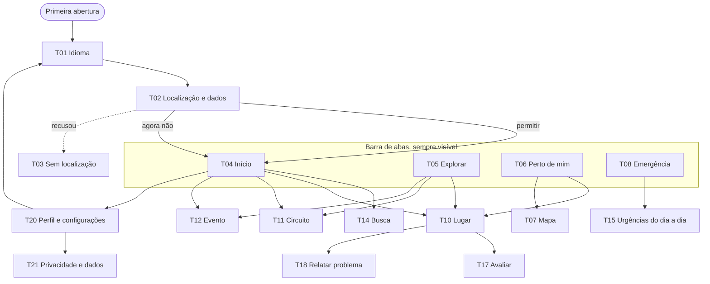

# Telas do Amado: mapa e comportamento

Mapeamento das telas que o app precisa ter, o que cada uma faz e o que já existe no Figma e no código. Serve de base para decidir o que desenhar e o que implementar. Tudo marcado como **proposta** é sugestão a confirmar com o time; nada aqui foi decidido além do que já está em `docs/CONTEXT.md`, no `CLAUDE.md` e nas decisões AD-001 a AD-004 de `.specs/STATE.md`.

Fontes: `docs/CONTEXT.md`, `CLAUDE.md`, o arquivo do Figma "Amado — Design System" (páginas Telas do MVP, Princípios e acessibilidade e Componentes) e o código em `src/`. Atualizado em 28/10/2026.

## 1. Onde estamos

| Fonte       | O que existe                                                                                                                                                                                                                                                          |
| ----------- | --------------------------------------------------------------------------------------------------------------------------------------------------------------------------------------------------------------------------------------------------------------------- |
| Figma       | 14 telas desenhadas: Idioma, Localização, Início, Perto de mim, Lugar (como folha e como página), Emergência, Emergência sem internet, três estados de Perto de mim (carregando, sem resultado, com erro), Perto de mim sem localização, Perfil e Privacidade e dados |
| Código      | 1 tela: **Emergência** (os 5 números, "Mais perto de você" com o conjunto de lugares vazio, aviso sem internet). Não há navegação, idiomas, onboarding nem as outras abas                                                                                             |
| Componentes | Button, Emergency Call, Input, Tag, Chip, Place Card, Place Row, Alert, Bottom Nav, Language Switch, Estados (carregando, vazio, erro), Bottom Sheet, Rating, Circuit Card, Icon Button, Top Bar, List Row, Option Row, Toggle Row e Info Row                         |

O caminho central da demonstração (Idioma, Localização, Início, Perto de mim, Lugar, Emergência) já está desenhado. O que falta no Figma é o resto da jornada do turista e tudo que sustenta o modelo de negócios.

## 2. Regras que valem para todas as telas

Vêm do contexto do projeto e dos princípios do Figma. Quebrar uma delas é bug de produto, não de estilo.

1. **Emergência sempre à mão.** O Figma diz que o acesso a socorro aparece em todas as telas, "a um toque". Isso volta a exigir a barra de abas (ou outro atalho fixo) assim que houver mais de uma tela, porque a AD-003 só a retirou por não existirem as outras abas.
2. **Nível 1 nunca patrocinado**, nunca ordenado por pagamento, sem cadastro e disponível offline.
3. **Três idiomas**: português, inglês e espanhol, escolhidos na primeira tela. Todo texto do app precisa existir nos três.
4. **Localização** é pedida na primeira abertura; recusar não bloqueia nada. Em emergência ela é usada na hora e não é guardada.
5. **Dados só de grupo**: nenhuma tela identifica uma pessoa nem mostra dado individual.
6. **Conteúdo pago** leva a etiqueta "Patrocinado" e nunca aparece no nível 1.
7. **Só Ilhéus** nesta versão. WhatsApp fora do MVP.
8. **Acessibilidade**: contraste AA, alvos de 48 px, foco visível, modos escuro e alto contraste, cor nunca como único sinal, ícone sempre com texto.
9. **Dado de emergência verificado**, nunca inventado.

## 3. Mapa de navegação

A barra de abas tem quatro destinos no Figma: Início, Explorar, Perto de mim e Emergência. **Perfil e configurações** não tem aba; o Figma só diz "você pode trocar depois, no perfil". Onde ele fica é decisão aberta (ver seção 8).

## 4. Inventário e prioridade

Prioridade é **proposta**: P1 é o que a demonstração e as regras inegociáveis pedem; P2 completa a jornada; P3 fica para depois do MVP.

| ID  | Tela                                 | Figma                 | Código  | Prioridade |
| --- | ------------------------------------ | --------------------- | ------- | ---------- |
| T01 | Idioma                               | sim                   | não     | P1         |
| T02 | Localização e dados                  | sim                   | não     | P1         |
| T03 | Sem localização                      | sim (novo)            | não     | P1         |
| T04 | Início                               | sim                   | não     | P1         |
| T05 | Explorar                             | não                   | não     | P2         |
| T06 | Perto de mim (e seus estados)        | sim (4 estados)       | não     | P1         |
| T07 | Mapa                                 | não                   | não     | P3         |
| T08 | Emergência                           | sim (2 estados)       | **sim** | P1         |
| T09 | Emergência: estado sem internet      | sim                   | **sim** | P1         |
| T10 | Lugar                                | sim (página e folha)  | não     | P1         |
| T11 | Circuito                             | não (só o card)       | não     | P2         |
| T12 | Evento                               | não                   | não     | P2         |
| T13 | Planejar a viagem                    | não                   | não     | P3         |
| T14 | Busca                                | parcial (só o campo)  | não     | P2         |
| T15 | Urgências do dia a dia (nível 2)     | não                   | não     | P2         |
| T17 | Avaliar um lugar                     | não (só o componente) | não     | P2         |
| T18 | Relatar um problema                  | não                   | não     | P2         |
| T19 | Sugerir uma dica ou evento (morador) | não                   | não     | P3         |
| T20 | Perfil e configurações               | sim (novo)            | não     | P1         |
| T21 | Privacidade e dados                  | sim (novo)            | não     | P1         |
| T22 | Instalar o app                       | não                   | não     | P3         |
| T23 | Página não encontrada                | não                   | não     | P3         |

A numeração salta o T16 de propósito: o prestador do nível 2 não tem tela de detalhe própria, usa a linha de lugar (Place Row) com ligar e rota.

## 5. Telas do turista, uma a uma

### T01 Idioma

- **Objetivo**: o turista escolhe português, inglês ou espanhol antes de qualquer coisa.
- **Quando aparece**: só na primeira abertura, e quando troca em T20.
- **Conteúdo**: marca, o título "Escolha o idioma" nos três idiomas, o seletor de idiomas (cada um escrito na própria língua), a frase "Você pode trocar depois, no perfil." e o botão Continuar.
- **Ações**: tocar um idioma o seleciona e já muda os textos da própria tela; Continuar guarda a escolha e leva a T02.
- **Estados**: o idioma do aparelho pode vir pré-selecionado (**proposta**).
- **Dados**: a escolha de idioma é uma preferência no aparelho, não um dado pessoal.
- **Depende de**: infraestrutura de idiomas (hoje não existe) e do componente Language Switch.

### T02 Localização e dados

- **Objetivo**: explicar o que o app coleta e pedir permissão, sem bloquear quem recusa.
- **Conteúdo**: três fatos curtos (só enquanto usa, em emergência na hora, dados só de grupos), o aviso "Você escolhe", e os botões Permitir localização e Agora não.
- **Ações**: Permitir pede a permissão do navegador; Agora não segue sem pedir. Os dois levam a T04.
- **Regras**: recusar mantém todas as funções; só deixa de contar nos dados de grupo.
- **Estados**: se o navegador negar, ir a T03 só quando a pessoa tentar usar algo que dependa da posição (**proposta**).
- **Dados**: guarda apenas o aceite do consentimento de dados, sem identificar a pessoa.

### T03 Sem localização

- **Objetivo**: não é uma tela cheia, é o estado de qualquer tela que dependa da posição quando a permissão foi negada ou não existe.
- **Conteúdo** (**proposta**): aviso com a razão, o que continua funcionando e como ligar a localização nas configurações do aparelho, sem pedir de novo em loop.
- **Onde se aplica**: Perto de mim (distâncias), Mapa, Início ("perto de você") e Emergência (já tratado: lista sem distância).

### T04 Início

- **Objetivo**: responder "o que fazer em Ilhéus hoje" e dar acesso rápido a tudo.
- **Conteúdo** (do Figma): título "Hoje em Ilhéus" com a data, campo de busca, chips de categoria (Tudo, Gastronomia, Cultura, Praias...), seção "Para fazer hoje" com cards de circuito e de lugar.
- **Ações**: tocar o campo abre T14; tocar um chip filtra a lista; tocar um card abre T10 ou T11; as abas navegam.
- **Estados**: carregando, vazio e erro, com os mesmos componentes de T06. Conteúdo patrocinado aparece marcado.
- **Dados**: lugares, eventos do dia e circuitos; ordem por relevância do dia e proximidade, nunca por pagamento sem etiqueta.

### T05 Explorar

- **Objetivo**: descobrir sem estar perto: pontos turísticos, eventos, hotéis, gastronomia e circuitos.
- **Conteúdo** (**proposta**): categorias como entrada (pontos turísticos, gastronomia, hotéis e pousadas, eventos, circuitos), com lista e filtros dentro de cada uma.
- **Ações**: escolher uma categoria abre a lista; tocar um item abre T10, T11 ou T12.
- **Por que existe**: é a aba "Explorar" da barra e a fase "antes de chegar" da jornada (planejar com circuitos, hotéis e eventos). Hoje não tem desenho.
- **Decisão aberta**: a diferença entre Explorar e Início (ver seção 8).

### T06 Perto de mim

- **Objetivo**: mostrar o que há perto, agora, do mais perto ao mais longe, "aberto agora".
- **Conteúdo** (do Figma): título, subtítulo "Aberto agora, do mais perto ao mais longe", chips de categoria e a lista de cards.
- **Ações**: chip filtra; card abre T10; um atalho abre T07.
- **Estados** (todos desenhados): normal, carregando, sem resultado ("Nenhum lugar aberto nesta categoria" com ação Ver todos os lugares) e com erro (com Tentar de novo e a hora do último dado bom).
- **Regras**: precisa da posição; sem ela, mostra T03. Conteúdo pago leva "Patrocinado".
- **Atenção ao nome**: esta aba "Perto de mim" é de **descoberta**; a seção "Mais perto de você" em T08 é de **emergência** (ver seção 8).

### T07 Mapa

- **Objetivo**: ver os lugares sobre o mapa, com a posição da pessoa.
- **Conteúdo** (**proposta**): mapa com pinos por categoria, filtro por chip, e ao tocar um pino abre a folha de T10.
- **Regras**: toda ação do mapa precisa ter uma alternativa por lista (acessibilidade). O mapa pesa e exige conexão para as imagens base; precisa de decisão de provedor, custo e uso offline.
- **Prioridade P3**: não estava no desenho e é o item mais caro.

### T08 Emergência (já implementada)

- **Objetivo**: ligar para socorro com um toque e achar o lugar mais próximo.
- **Conteúdo**: os 5 números com o nome do serviço e a linha em outro idioma; "Mais perto de você" com o lugar mais próximo de cada categoria (polícia, hospital, UPA, bombeiros), distância, Ligar e Rota; aviso sem internet.
- **Estado hoje**: o conjunto de lugares vai **vazio** até o time levantar dados verificados (AD-002).
- **Falta**: os nomes em espanhol (o Figma mostra três idiomas, a captura implementada mostra dois), a barra de abas e o link para T15.

### T10 Lugar

- **Objetivo**: decidir se vai: tipo, nome, distância, horário, como chegar, contato.
- **Hoje**: só existe como folha que sobe sobre a lista (Figma). Uma página inteira faz falta para hotéis, restaurantes e pontos com mais informação.
- **Conteúdo** (**proposta**): foto, nome, tipo, distância e tempo a pé, horário, endereço, contato, descrição curta, selo "Verificado", etiqueta "Patrocinado" quando pago, e as ações Ver rota, Ligar e Avaliar.
- **Ações**: Ver rota abre o app de mapas com o destino; Ligar abre o discador; Avaliar abre T17; "Relatar problema" abre T18.
- **Estados**: carregando, erro e sem foto.

### T11 Circuito

- **Objetivo**: a assinatura do Amado, "contada por quem ama": um roteiro montado por moradores e guias para tirar o turista do centro.
- **Conteúdo** (**proposta**): título, quem montou, duração, número de paradas, onde começa, lista ordenada de paradas (cada uma abre T10) e um botão para iniciar o roteiro.
- **Ações**: Iniciar leva à primeira parada com a rota; cada parada marcada como feita é só uma preferência no aparelho.
- **Dados**: circuitos feitos com a Secretaria de Turismo e guias, com validação antes de publicar.

### T12 Evento

- **Objetivo**: saber o que acontece, onde e quando, inclusive nas datas da viagem.
- **Conteúdo** (**proposta**): lista por data com filtros, e o detalhe com nome, data e hora, local, descrição e o "Patrocinado" quando for promoção paga.
- **Ações**: o local abre T10; "adicionar ao calendário" é **proposta**.
- **Dados**: cadastrados por empresas e sugeridos por moradores, validados antes de publicar.

### T13 Planejar a viagem

- **Objetivo**: a fase "antes de chegar": escolher as datas e ver circuitos, hotéis e eventos desse período.
- **Conteúdo** (**proposta**): seletor de datas e a lista resultante.
- **Prioridade P3**: pode virar um filtro de data em T05 e T12, sem tela própria.

### T14 Busca

- **Objetivo**: achar lugares, circuitos e eventos digitando.
- **Conteúdo** (**proposta**): campo com sugestões, resultados agrupados por tipo, estado sem resultado.
- **Ações**: tocar um resultado abre T10, T11 ou T12.
- **Regras**: a busca roda no aparelho ou no servidor, mas termos digitados não identificam a pessoa nem viram dado individual.

### T15 Urgências do dia a dia (nível 2)

- **Objetivo**: ajudar com o que não é risco de vida: chaveiro, mecânico, guincho, borracheiro, farmácia de plantão, eletricista e encanador 24 h.
- **Conteúdo** (**proposta**): lista de categorias; dentro de cada uma, prestadores verificados com a linha de lugar (Place Row, com a etiqueta opcional "Aberto 24 h"), Ligar e Rota.
- **Regras**: ordenados por **proximidade, sem ordem comprada**; só prestadores verificados; sem cadastro para o turista usar.
- **Entrada**: link a partir de T08, abaixo dos números do nível 1, para o nível 1 continuar sozinho no topo.
- **Dados**: prestadores verificados pelo time ou por parceiros; sem dado inventado.

### T17 Avaliar um lugar

- **Objetivo**: o passo 3 da jornada, "avaliar lugares", que alimenta os dados.
- **Conteúdo**: pergunta, as cinco estrelas com o valor também em texto, e o aviso de que a avaliação é anônima e só conta em grupo. Envio opcional de um comentário curto (**proposta**).
- **Ações**: tocar uma estrela marca a nota; Enviar grava; um retorno de agradecimento confirma.
- **Regras**: anônimo, dado agregado; quem recusou os dados em T02 pode avaliar sem entrar na contagem (**proposta**).

### T18 Relatar um problema

- **Objetivo**: avisar que algo está errado (informação desatualizada, lugar fechado, risco), também parte do passo 3.
- **Conteúdo** (**proposta**): lista de motivos, campo de detalhe opcional, Enviar.
- **Regras**: não identifica a pessoa. Problema de **emergência** (dado errado de telefone ou lugar) vai com prioridade para o time verificar.

### T19 Sugerir uma dica ou evento (morador)

- **Objetivo**: o morador ajuda a curar dicas e eventos locais, o que mantém o app vivo na baixa temporada.
- **Conteúdo** (**proposta**): formulário curto e a explicação de que nada é publicado sem validação.
- **Prioridade P3**: depende do fluxo de validação do time, que ainda não existe.

### T20 Perfil e configurações

- **Objetivo**: concentrar o que a pessoa escolhe sobre o app.
- **Conteúdo** (**proposta**): idioma (leva a T01), aparência (claro, escuro, alto contraste, que o Figma diz que deve ser oferecido nas configurações), privacidade e dados (T21), sobre o app e versão.
- **Por que P1**: o Figma já promete "trocar depois, no perfil" e o alto contraste nas configurações.

### T21 Privacidade e dados

- **Objetivo**: rever e mudar o consentimento dado em T02, em linguagem simples.
- **Conteúdo** (**proposta**): o que é coletado, o aceite atual, o botão para mudar, e a explicação de que recusar não tira nada do app.

### T22 Instalar o app

- **Objetivo**: o canal é o QR code que abre direto no celular, sem baixar. Convidar a "adicionar à tela inicial" melhora o uso e o offline.
- **Conteúdo** (**proposta**): um aviso discreto e dispensável. É P3 porque exige HTTPS, e o ambiente de desenvolvimento hoje roda em HTTP.

### T23 Página não encontrada

- **Objetivo**: técnica. Mostra uma saída clara e o atalho de emergência.

## 6. Estados que quase toda tela precisa

Já existem como componentes. O ponto é lembrar de desenhar e implementar para cada tela de lista.

| Estado          | Como aparece                                                                                    |
| --------------- | ----------------------------------------------------------------------------------------------- |
| Carregando      | mesmo layout com barras planas, sem brilho animado, sem deslocar nada quando o dado chega       |
| Vazio           | mantém a moldura e diz o que fazer                                                              |
| Erro            | dentro do bloco que falhou, diz o que falhou e quando o dado estava bom, com Tentar de novo     |
| Sem internet    | aviso no topo; o que está salvo no aparelho continua funcionando                                |
| Sem localização | T03                                                                                             |
| Fora de Ilhéus  | **proposta**: aviso de que a primeira versão cobre só Ilhéus, mantendo os números de emergência |

## 7. Fora do app do turista

O modelo de negócios depende de outras superfícies, que **não** são telas do PWA do turista e pedem decisão própria de produto, acesso e identidade:

| Superfície               | O que faria                                                                                  | Observação                                                 |
| ------------------------ | -------------------------------------------------------------------------------------------- | ---------------------------------------------------------- |
| Cadastro da empresa      | o trade se cadastra de graça, com apoio humano na verificação                                | exige conta; o contexto prevê apoio humano no início       |
| Painel do trade          | destaque "patrocinado", promoção de eventos e ofertas, dados do público que chega ao negócio | é a fonte de receita do início                             |
| Relatórios da Secretaria | dados agregados e anônimos de comportamento, para planejar o destino                         | médio prazo, quando houver volume de uso; só dado de grupo |

Para o pitch, vale mostrar o painel do trade como desenho, sem implementar.

## 8. Decisões abertas

**Resolvidas em 28/10/2026**

- **Recorte:** primeiro o P1 completo, depois o P2.
- **Perfil:** ícone no cabeçalho das telas de aba, e a barra segue com as 4 abas. A tela de **Emergência fica sem o ícone**, de propósito: é a tela de ação rápida e o Perfil não a ajuda.
- **Explorar:** catálogo por categoria. O Início fica com "hoje e perto".
- **Conteúdo:** exemplos marcados com a etiqueta "Exemplo", sem telefone, endereço nem coordenada inventados. O nível 1 de emergência segue vazio até haver fonte verificada.

**Ainda abertas**

Cada uma muda o que se desenha ou se implementa.

1. **Dois "Perto de mim"**: a aba de descoberta e a seção de emergência usam nomes parecidos. O Figma diz que a mesma ação tem sempre o mesmo nome. Sugestão: manter "Perto de mim" na aba e usar "Socorro mais próximo" na emergência.
2. **Barra de abas e emergência**: o Figma pede acesso a socorro em todas as telas. Quando a barra volta, ela precisa vir com a primeira tela além de Emergência.
3. **Idiomas na emergência**: o Figma lista os nomes em português, inglês e espanhol; a captura implementada mostra só português e inglês.
4. **Categorias**: a lista dos chips (Gastronomia, Cultura, Praias...) e dos tipos (ponto turístico, evento, hotel, gastronomia, circuito) ainda não está fechada.
5. **Mapa**: entra no MVP? Qual provedor? Funciona offline?
6. **Conteúdo de verdade**: de onde vêm lugares, eventos, circuitos e prestadores, e quem valida. Hoje não existe nenhum dado verificado.
7. **Fora de Ilhéus**: o que o app faz para quem abre fora da cidade?
8. **Trade**: o painel entra como desenho no pitch ou como protótipo funcional?

## 9. Ordem sugerida para desenhar o que falta

Pensando no que o Demo Day e as regras inegociáveis pedem, e não só em completude:

1. **T20 Perfil e configurações** e **T21 Privacidade e dados**: o Figma já os promete e o alto contraste depende deles.
2. **T10 Lugar** como página: a folha atual não comporta hotéis e restaurantes.
3. **T03 Sem localização**: é o caminho de quem recusa, e a regra diz que recusar não pode bloquear nada.
4. **T15 Urgências do dia a dia**: completa o "peça ajuda" além dos 5 números.
5. **T05 Explorar** e **T11 Circuito**: sustentam "descubra" e "contada por quem ama".
6. **T17 e T18**: fecham a jornada e geram os dados do pitch.
7. O resto (T07, T12, T13, T14, T19, T22, T23) depois.

## 10. Como isso vira implementação

Antes de qualquer tela nova, três peças de base servem a todas e hoje não existem:

- **Navegação**: um roteador e a barra de abas, com a emergência sempre acessível.
- **Idiomas**: as três línguas e a escolha de T01 valendo para todo texto.
- **Dados**: o formato de lugar, evento, circuito, prestador e avaliação, com a regra de que nada é inventado e nada patrocinado entra no nível 1.

Cada tela implementada deve seguir o mesmo fluxo da emergência: plano com critérios e decisões, checks com provas, construção e verificação independente (`tlc-spec-lean`).
